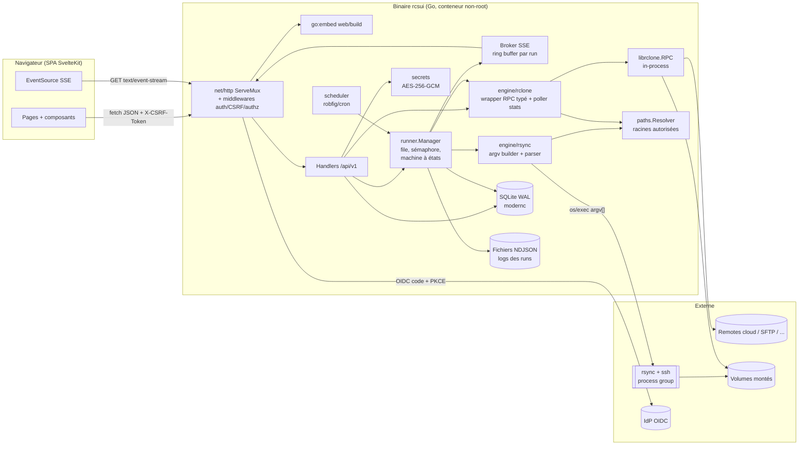
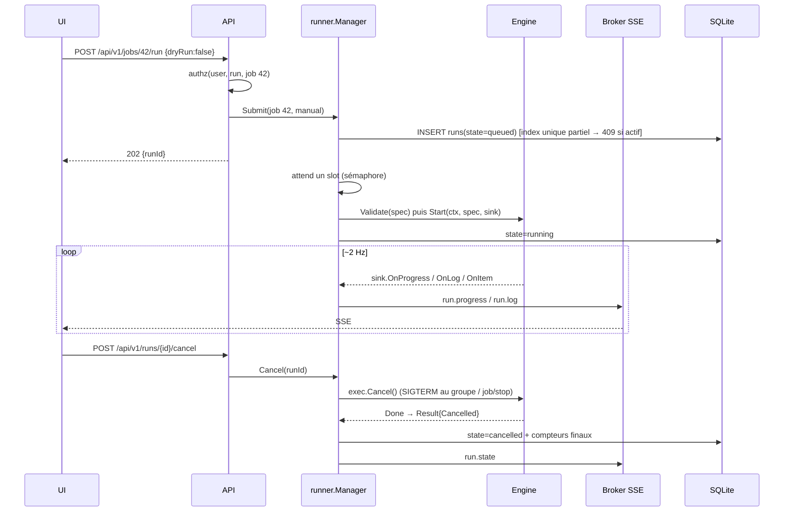
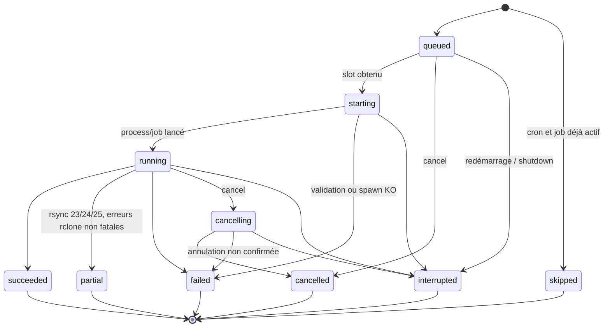

# RcsUI — Plan de projet

> UI web auto-hébergée pour piloter **rclone** et **rsync**. Cible : homelab/NAS, quelques utilisateurs, un seul `docker run`.
> Rédigé le 2026-11-21. Toutes les versions ci-dessous ont été vérifiées à cette date sur les sources officielles.

## 0. Versions de référence et décisions de cadrage

| Composant | Version retenue | Source / remarque |
|---|---|---|
| Go | **1.27.4** | go.dev/dl. rclone master exige `go 1.26.0` dans son `go.mod` : compatible. |
| rclone (lib) | **v1.76.0** (06/11/2026) | Paquet `github.com/rclone/rclone/librclone/librclone` : `Initialize()`, `Finalize()`, `RPC(method, input string) (output string, status int)`. **API marquée « experimental »** dans le README. Licence MIT. |
| rsync (image) | **≥ 3.5.2** (04/11/2026, corrige CVE-2026-119741) | Vérifier la version fournie par le paquet Alpine (§10). |
| modernc.org/sqlite | **v1.62.0** | Driver `"sqlite"`, pragmas via `_pragma=` dans le DSN. |
| robfig/cron/v3 | **v3.0.1** (2020) | Dernier commit : 01/2021. Voir risques §12. |
| SvelteKit / adapter-static / Svelte / Vite | **3.4.0 / 4.0.1 / 5.59.1 / 8.3.8** | Registre npm. Svelte 5 (runes). |
| coreos/go-oidc/v3 | **v3.21.0** | + `golang.org/x/oauth2` v0.38.0 |
| golang.org/x/crypto | **v0.59.0** | `argon2.IDKey`, `ssh`, `ssh/knownhosts` |

**Réponses de cadrage intégrées :**

1. **RBAC** : rôles `admin` / `operator` / `viewer`, plus des droits par job (`view` < `run` < `edit`) et par remote (`use`).
2. **Auth** : locale (argon2id) **+ OIDC** optionnel, derrière un reverse proxy qui termine le TLS.
3. **SSH** : deux modes. Clés **gérées par l'app** (générées ou importées, chiffrées au repos, known_hosts enrôlés en TOFU) **et/ou** un **`~/.ssh` monté** en lecture seule.
4. **Runtime** : conteneur **non-root** (PUID/PGID). `rclone.conf` **exclusif à l'app** sur le volume, en 0600, chiffré depuis M10 (mot de passe dérivé de la clé maître).

**Routage HTTP : stdlib `net/http`, sans `chi`.** Le `ServeMux` de Go 1.22+ gère méthode, wildcards `{id}` et `PathValue`, et Go fournit `http.CrossOriginProtection`. `chi` n'apporterait que le chaînage de middlewares, qu'une fonction `chain(h, mws...)` de 10 lignes remplace.

---

## 1. Architecture

### 1.1 Composants et flux



### 1.2 Séquence d'un run



### 1.3 Arborescence du repo

```
RcsUI/
├── cmd/rcsui/main.go              # wiring, config, signaux, shutdown gracieux
├── internal/
│   ├── config/                    # env (+ *_FILE pour secrets), validation
│   ├── server/                    # ServeMux, middlewares (log, recover, auth, csrf, authz, bodylimit), SPA fallback
│   ├── api/                       # handlers : auth, users, jobs, runs, remotes, browse, ssh, settings, events ; dto.go
│   ├── auth/                      # password (argon2id), sessions, oidc, csrf, ratelimit
│   ├── authz/                     # Can(user, action, resource) — politique centralisée
│   ├── store/                     # db.go (pools R/W), migrate.go, migrations/*.sql, repos
│   ├── engine/                    # interfaces communes (Engine, Execution, Sink, Progress, Result)
│   │   ├── rsync/                 # options.go (whitelist), argv.go, parser.go, exitcodes.go, ssh.go
│   │   └── rclone/                # lib.go (Initialize + RPC typés), fsstring.go, stats.go,
│   │                              # loghandler.go, mask.go, providers.go, backends.go
│   ├── runner/                    # manager.go, statemachine.go, queue.go, recovery.go, logwriter.go
│   ├── scheduler/                 # wrapper cron derrière une interface
│   ├── events/                    # broker pub/sub + ring buffers
│   ├── paths/                     # Resolver (racines, symlinks), browse local via os.Root
│   ├── sshkeys/                   # génération ed25519, import, known_hosts, construction de -e
│   ├── secrets/                   # AES-GCM, clé maître
│   └── audit/
├── web/                           # SvelteKit
│   ├── src/lib/api/               # client fetch, types générés (tygo), sse.svelte.ts
│   ├── src/lib/components/
│   ├── src/routes/
│   ├── embed.go                   # package web ; //go:embed all:build
│   └── svelte.config.js
├── testdata/rsync/                # sorties rsync réelles (fixtures)
├── deploy/entrypoint.sh
├── Dockerfile
├── Makefile
├── .github/workflows/ci.yml
└── PLAN.md
```

Le préfixe **`all:`** de `go:embed all:build` est indispensable : SvelteKit produit `_app/`, et `go:embed` ignore par défaut les fichiers qui commencent par `_` ou `.`.

---

## 2. Modèle de données (SQLite)

### 2.1 Connexion

- DSN : `file:/data/rcsui.db?_pragma=journal_mode(WAL)&_pragma=busy_timeout(5000)&_pragma=foreign_keys(1)&_pragma=synchronous(NORMAL)`.
- **Deux pools** :
  - écriture, avec `SetMaxOpenConns(1)`, ce qui sérialise les écritures et évite `SQLITE_BUSY` ;
  - lecture, avec `SetMaxOpenConns(4)`.
- Horodatages en `INTEGER` (epoch ms UTC).
- ID de run : **ULID** (triable, utilisable dans les URL et les noms de fichiers).
- **`/data` doit être un disque local.** SQLite en WAL n'est pas fiable sur NFS/SMB. Le README le documente.

### 2.2 Tables

```sql
-- 0001_init.sql
CREATE TABLE users (
  id              INTEGER PRIMARY KEY,
  username        TEXT NOT NULL UNIQUE COLLATE NOCASE,
  password_hash   TEXT,                       -- NULL si compte OIDC-only ; PHC "$argon2id$v=19$m=65536,t=3,p=2$..."
  role            TEXT NOT NULL CHECK (role IN ('admin','operator','viewer')),
  oidc_issuer     TEXT,
  oidc_subject    TEXT,
  must_change_pw  INTEGER NOT NULL DEFAULT 0,
  disabled        INTEGER NOT NULL DEFAULT 0,
  created_at      INTEGER NOT NULL,
  updated_at      INTEGER NOT NULL,
  last_login_at   INTEGER,
  UNIQUE (oidc_issuer, oidc_subject)
);

CREATE TABLE sessions (
  token_hash    BLOB PRIMARY KEY,             -- SHA-256 du token ; le token brut n'existe que dans le cookie
  user_id       INTEGER NOT NULL REFERENCES users(id) ON DELETE CASCADE,
  csrf_token    TEXT NOT NULL,
  created_at    INTEGER NOT NULL,
  last_seen_at  INTEGER NOT NULL,
  expires_at    INTEGER NOT NULL,             -- absolu (7 j) ; l'idle (24 h) se calcule via last_seen_at
  ip            TEXT,
  user_agent    TEXT
);
CREATE INDEX sessions_user ON sessions(user_id);
CREATE INDEX sessions_exp  ON sessions(expires_at);

CREATE TABLE ssh_identities (
  id            INTEGER PRIMARY KEY,
  name          TEXT NOT NULL UNIQUE,
  key_type      TEXT NOT NULL,                -- ssh-ed25519 (génération) ; import : ed25519/rsa/ecdsa
  public_key    TEXT NOT NULL,                -- format authorized_keys
  private_enc   BLOB NOT NULL,                -- AES-256-GCM(nonce||ciphertext) du PEM OpenSSH
  fingerprint   TEXT NOT NULL,                -- SHA256:...
  created_at    INTEGER NOT NULL
);

CREATE TABLE ssh_known_hosts (
  id            INTEGER PRIMARY KEY,
  host          TEXT NOT NULL,
  port          INTEGER NOT NULL DEFAULT 22,
  key_type      TEXT NOT NULL,
  public_key    TEXT NOT NULL,
  fingerprint   TEXT NOT NULL,
  added_by      INTEGER REFERENCES users(id) ON DELETE SET NULL,
  created_at    INTEGER NOT NULL,
  UNIQUE (host, port, key_type)
);
-- /data/ssh/known_hosts est régénéré depuis cette table (via knownhosts.Line) à chaque modification.

CREATE TABLE job_definitions (
  id              INTEGER PRIMARY KEY,
  name            TEXT NOT NULL UNIQUE,
  engine          TEXT NOT NULL CHECK (engine IN ('rsync','rclone')),
  mode            TEXT NOT NULL CHECK (mode IN ('copy','sync','move')),
  source_json     TEXT NOT NULL,              -- Endpoint typé (§4.1)
  destination_json TEXT NOT NULL,
  options_json    TEXT NOT NULL DEFAULT '{}', -- RsyncOptions | RcloneOptions, versionné {"v":1,...}
  ssh_identity_id INTEGER REFERENCES ssh_identities(id) ON DELETE RESTRICT,
  schedule_cron   TEXT,                       -- NULL = manuel uniquement
  schedule_on     INTEGER NOT NULL DEFAULT 0,
  retry_interrupted INTEGER NOT NULL DEFAULT 0,
  owner_id        INTEGER REFERENCES users(id) ON DELETE SET NULL,
  created_at      INTEGER NOT NULL,
  updated_at      INTEGER NOT NULL
);

CREATE TABLE job_grants (
  job_id      INTEGER NOT NULL REFERENCES job_definitions(id) ON DELETE CASCADE,
  user_id     INTEGER NOT NULL REFERENCES users(id) ON DELETE CASCADE,
  permission  TEXT NOT NULL CHECK (permission IN ('view','run','edit')),
  PRIMARY KEY (job_id, user_id)
);

CREATE TABLE remote_grants (                  -- un operator n'utilise que les remotes accordés
  remote_name TEXT NOT NULL,
  user_id     INTEGER NOT NULL REFERENCES users(id) ON DELETE CASCADE,
  PRIMARY KEY (remote_name, user_id)
);

CREATE TABLE ssh_identity_grants (
  identity_id INTEGER NOT NULL REFERENCES ssh_identities(id) ON DELETE CASCADE,
  user_id     INTEGER NOT NULL REFERENCES users(id) ON DELETE CASCADE,
  PRIMARY KEY (identity_id, user_id)
);

CREATE TABLE runs (
  id                 TEXT PRIMARY KEY,        -- ULID
  job_id             INTEGER REFERENCES job_definitions(id) ON DELETE SET NULL,
  job_name           TEXT NOT NULL,           -- dénormalisé (survit à la suppression du job)
  engine             TEXT NOT NULL,
  trigger            TEXT NOT NULL CHECK (trigger IN ('manual','schedule','retry')),
  triggered_by       INTEGER REFERENCES users(id) ON DELETE SET NULL,
  dry_run            INTEGER NOT NULL DEFAULT 0,
  state              TEXT NOT NULL CHECK (state IN
                     ('queued','starting','running','cancelling',
                      'succeeded','partial','failed','cancelled','interrupted','skipped')),
  spec_json          TEXT NOT NULL,           -- snapshot de la définition au lancement
  queued_at          INTEGER NOT NULL,
  started_at         INTEGER,
  finished_at        INTEGER,
  exit_code          INTEGER,                 -- rsync
  rclone_job_id      INTEGER,                 -- rclone
  pid                INTEGER,                 -- rsync (pgid = pid), pour la récupération
  error_message      TEXT,
  bytes_done         INTEGER NOT NULL DEFAULT 0,
  bytes_total        INTEGER,
  files_done         INTEGER NOT NULL DEFAULT 0,
  files_total        INTEGER,
  files_deleted      INTEGER NOT NULL DEFAULT 0,
  errors_count       INTEGER NOT NULL DEFAULT 0,
  log_path           TEXT,                    -- relatif à /data/logs
  log_size           INTEGER NOT NULL DEFAULT 0
);
CREATE INDEX runs_job_time ON runs(job_id, queued_at DESC);
CREATE INDEX runs_state    ON runs(state);
CREATE INDEX runs_time     ON runs(queued_at DESC);
-- Garantie en base : un seul run actif par job (exigence 8).
CREATE UNIQUE INDEX runs_one_active_per_job ON runs(job_id)
  WHERE state IN ('queued','starting','running','cancelling');

CREATE TABLE settings (key TEXT PRIMARY KEY, value TEXT NOT NULL);
-- ex. max_concurrent=2, log_retention_days=90, rsync_vanished_is_success=true

CREATE TABLE audit_log (
  id       INTEGER PRIMARY KEY,
  at       INTEGER NOT NULL,
  user_id  INTEGER REFERENCES users(id) ON DELETE SET NULL,
  action   TEXT NOT NULL,                     -- job.create, run.cancel, remote.update, user.role, ...
  target   TEXT,
  details  TEXT                               -- JSON, jamais de secrets
);
CREATE INDEX audit_at ON audit_log(at DESC);
```

**Logs des runs : fichiers, pas en base.**

- Emplacement : `/data/logs/runs/2026/11/<ulid>.ndjson`, compressé en `.ndjson.gz` à la fin du run, avec un petit index `.idx` (offset tous les 1000 événements) pour paginer après compression.
- Une ligne par événement : `{"t":…,"s":"stdout|stderr|rclone|system","lvl":"info","msg":"…"}`. Les items suivent la forme `{"t":…,"item":{"op":"send","kind":"f","flags":">f+++++++++","size":123,"path":"a/b"}}`.
- Pourquoi : un `--itemize-changes` sur un gros arbre produit des millions de lignes, ce qui ferait gonfler la base.

### 2.3 Stratégie de migration

- Fichiers `internal/store/migrations/NNNN_description.sql` embarqués (`embed.FS`). Runner maison d'environ 80 lignes, sans dépendance.
- Table `schema_migrations(version INTEGER PRIMARY KEY, checksum TEXT, applied_at INTEGER)`.
- Chaque migration s'exécute dans sa propre transaction. Le checksum SHA-256 est vérifié : modifier une migration déjà appliquée provoque une erreur fatale.
- **Forward-only.** Avant toute migration en attente, une copie est faite avec `VACUUM INTO '/data/backups/rcsui-v<N>-<ts>.db'` ; les 5 dernières sont conservées.
- Les tests appliquent toutes les migrations depuis zéro, et aussi depuis une fixture de chaque version publiée.

---

## 3. API HTTP

Conventions :

- Préfixe `/api/v1`, JSON, erreurs au format `{"error":{"code":"job_active","message":"…","fields":{"source":"outside allowed roots"}}}`.
- Les mutations (POST/PUT/PATCH/DELETE) exigent le cookie de session **et** l'en-tête `X-CSRF-Token`.
- Corps de requête limité à 1 MiB.
- Pagination par curseur : `?limit=50&cursor=…` renvoie `{"items":[…],"nextCursor":"…"}`.
- Accès : **A** = admin ; **O** = operator avec le grant requis ; **V** = viewer avec grant `view`. A ⊃ O ⊃ V.

### 3.1 Authentification

| Méthode | Chemin | Payload → Réponse | Accès |
|---|---|---|---|
| POST | `/auth/login` | `{"username","password"}` → `200 {"user":{…},"csrfToken":"…"}` + `Set-Cookie` | public, rate-limité |
| POST | `/auth/logout` | → `204` | session |
| GET | `/auth/me` | → `{"user":{"id","username","role","mustChangePassword"},"csrfToken","oidcEnabled"}` | session |
| POST | `/auth/password` | `{"current","new"}` → `204` (révoque les autres sessions) | session |
| GET | `/auth/oidc/login` | → `302` IdP (state, nonce et verifier PKCE en cookie court signé) | public |
| GET | `/auth/oidc/callback` | `?code&state` → `302 /` + session | public |
| GET | `/healthz` | → `200 {"status":"ok"}` | public |

### 3.2 Utilisateurs et audit (A)

`GET /users` · `POST /users {"username","password","role"}` · `PATCH /users/{id} {"role"?,"disabled"?,"password"?}` · `DELETE /users/{id}` · `GET /audit?cursor=`

### 3.3 Jobs

| Méthode | Chemin | Détail | Accès |
|---|---|---|---|
| GET | `/jobs` | Jobs visibles, avec `lastRun` et `nextRunAt`. | V |
| POST | `/jobs` | Crée un job ; le créateur reçoit `edit`. | O |
| GET | `/jobs/{id}` | Détail. | V |
| PUT | `/jobs/{id}` | Remplacement complet. | O edit |
| DELETE | `/jobs/{id}` | `409` si un run est actif. | O edit |
| POST | `/jobs/validate` | Corps de POST, sans sauvegarde. Renvoie les erreurs par champ et un aperçu : `{"preview":{"argv":["rsync","-rlptD",…]}}` ou `{"preview":{"rpc":"sync/sync","input":{…}}}`. | O |
| POST | `/jobs/{id}/run` | `{"dryRun":false}` → `202 {"runId":"01JD…"}` ; `409 job_active` si un run est déjà actif. | O run |
| GET/PUT | `/jobs/{id}/grants` | `[{"userId":3,"permission":"run"}]` | A ou owner |
| GET | `/schedule/preview?cron=0 3 * * *` | → `{"next":["2026-11-22T03:00:00+01:00",…]}` (5 prochaines occurrences, fuseau `TZ`). | O |

Exemple `POST /jobs` (rsync over SSH) :

```json
{
  "name": "photos → nas2",
  "engine": "rsync",
  "mode": "sync",
  "source": {"type": "local", "path": "/mnt/photos/", "contentsOnly": true},
  "destination": {"type": "ssh", "host": "nas2.lan", "port": 22, "user": "backup",
                  "path": "/volume1/photos/", "identity": {"managed": 4}},
  "options": {"v": 1, "delete": "after", "checksum": false, "compress": false,
              "partial": true, "hardLinks": true, "fakeSuper": false,
              "excludes": ["*.tmp", ".DS_Store"], "maxDelete": 500,
              "bwLimitKiB": null, "timeoutSec": 300, "accurateProgress": false},
  "schedule": {"cron": "0 3 * * *", "enabled": true}
}
```

Exemple rclone :

```json
{
  "name": "docs → b2",
  "engine": "rclone",
  "mode": "copy",
  "source": {"type": "local", "path": "/mnt/docs"},
  "destination": {"type": "remote", "remote": "b2crypt", "path": "docs"},
  "options": {"v": 1, "transfers": 4, "checkers": 8, "checksum": true,
              "createEmptySrcDirs": false, "excludes": ["**/node_modules/**"],
              "maxAge": null, "trackRenames": false}
}
```

### 3.4 Runs (visibilité héritée du job)

| Méthode | Chemin | Détail |
|---|---|---|
| GET | `/runs?jobId=&state=&cursor=` | Historique filtré par authz. |
| GET | `/runs/{id}` | Snapshot, avec la progression live si actif. |
| POST | `/runs/{id}/cancel` | `202`, idempotent ; `409` si terminal (O run). |
| POST | `/runs/{id}/retry` | `202 {"runId"}`, rejoue le `spec_json` (O run). |
| GET | `/runs/{id}/logs?from=<offset>&limit=500&level=` | → `{"lines":[…],"next":<offset>,"eof":bool}` |
| GET | `/runs/{id}/logs.ndjson` | Téléchargement complet. |
| GET | `/runs/{id}/items?op=send\|delete\|mkdir&cursor=` | Changements itemisés (résultat du dry-run). |

### 3.5 Remotes rclone (écriture A, lecture limitée aux remotes accordés)

| Méthode | Chemin | Détail |
|---|---|---|
| GET | `/rclone/providers` | Schéma simplifié dérivé de `config/providers`, mis en cache (exemple ci-dessous). |
| GET | `/remotes` | `[{"name":"b2crypt","type":"crypt"}]` |
| GET | `/remotes/{name}` | `{"name","type","params":{"account":"abc","key":{"secret":true,"set":true}}}`. **Jamais de secret en clair.** |
| POST | `/remotes` | `{"name","type","params":{…}}` → `config/create` avec `opt.obscure=true` et `opt.nonInteractive=true`. Si rclone pose une question : `200 {"done":false,"state":"…","question":{option}}` |
| POST | `/remotes/{name}/continue` | `{"state","result"}` : suite de la machine à états de config. |
| PUT | `/remotes/{name}` | Seuls les champs envoyés sont modifiés ; un secret absent ou valant `{"keep":true}` reste inchangé. |
| DELETE | `/remotes/{name}` | `409` si un job l'utilise. |
| POST | `/remotes/{name}/test` | `operations/list` à la racine avec `opt.dirsOnly`, timeout 15 s → `{"ok":true,"latencyMs":420}` ou `{"ok":false,"error":"…"}` |
| GET/PUT | `/remotes/{name}/grants` | A |

Exemple de schéma renvoyé par `/rclone/providers` :

```json
[{"type":"s3","description":"Amazon S3 Compliant…","options":[
  {"name":"provider","help":"…","type":"string","required":false,"advanced":false,
   "examples":[{"value":"AWS","help":"…"}],"exclusive":true,"secret":false,"provider":""},
  {"name":"secret_access_key","type":"string","secret":true,"advanced":false,"provider":""}]}]
```

`secret` vaut `IsPassword || Sensitive`.

### 3.6 Explorateur

`GET /browse?loc=local&path=/mnt/photos` ou `GET /browse?loc=remote&remote=b2crypt&path=docs` renvoie :

```json
{"path":"…","entries":[{"name":"2024","dir":true,"size":0,"modTime":"…"}],"truncated":false}
```

Pour un chemin local, la liste est limitée aux racines autorisées (`GET /browse/roots` les liste). Pour un remote, l'utilisateur doit avoir le grant correspondant. Maximum 2000 entrées.

### 3.7 SSH et système

| Méthode | Chemin | Détail | Accès |
|---|---|---|---|
| GET | `/ssh/identities` | → `[{"id","name","keyType","publicKey","fingerprint"}]` | O (identités accordées) |
| POST | `/ssh/identities` | `{"name","generate":true}` ou `{"name","privateKey":"-----BEGIN…","passphrase"?}` | A |
| DELETE | `/ssh/identities/{id}` | | A |
| GET | `/ssh/known-hosts` | | O |
| POST | `/ssh/known-hosts/scan` | `{"host","port"}` → `{"keys":[{"type","fingerprint","key"}]}`. Aucune écriture. | A |
| POST | `/ssh/known-hosts` | `{"host","port","key"}`. Confirmation explicite après lecture de l'empreinte. | A |
| DELETE | `/ssh/known-hosts/{id}` | | A |
| POST | `/ssh/test` | `{"host","port","user","identity":{"managed":4}\|{"mounted":true}}` → `ssh … true` avec un timeout de 10 s. | O |
| GET | `/system/info` | Versions (app, rclone, rsync, ssh), racines, `sshMountedAvailable`, limites. | V |
| GET/PUT | `/settings` | | A |

### 3.8 Server-Sent Events

Deux flux :

- **`GET /api/v1/events`** : flux global de l'utilisateur. Changements d'état et progression résumée (1 Hz) des runs visibles. Alimente le dashboard et les listes.
- **`GET /api/v1/runs/{id}/events`** : flux détaillé d'un run. Progression (2 Hz), logs par lots (250 ms), items.

```
retry: 3000

id: 01JD8XQ:1287
event: run.progress
data: {"runId":"01JD8XQ","jobId":42,"state":"running","bytesDone":1238099,"bytesTotal":9000000,"filesDone":5,"filesTotal":396,"totalsExact":false,"speedBps":149872,"etaSec":52,"percent":13.7,"deletes":0,"errors":0,"current":[{"name":"a/b.jpg","percent":63,"size":782448}]}

id: 01JD8XQ:1288
event: run.log
data: {"runId":"01JD8XQ","fromOffset":20480,"toOffset":21033,"lines":[{"t":1763712000123,"s":"stderr","lvl":"warn","msg":"file has vanished: …"}]}

id: 01JD8XQ:1290
event: run.state
data: {"runId":"01JD8XQ","jobId":42,"from":"cancelling","to":"cancelled","finishedAt":1763712100000,"exitCode":20}

: ping
```

- **`id` = `<runId>:<seq>`**, avec un `seq` monotone par run. Pour le flux global, l'`id` est un `seq` global. Chaque flux garde un ring buffer de 500 événements, conservé 5 min après la fin du run.
- **Reprise** : le navigateur renvoie `Last-Event-ID`. Le serveur rejoue les événements suivants. Si l'ID n'est plus dans le buffer, il envoie `event: resync` et le client recharge le snapshot REST et les logs depuis le dernier offset connu.
- **Heartbeat** : `: ping` toutes les 15 s.
- **En-têtes** : `Content-Type: text/event-stream`, `Cache-Control: no-store`, `X-Accel-Buffering: no`. Pas de compression sur ces routes.
- **Timeouts** : le `WriteTimeout` global du serveur couperait le flux. Sur les routes SSE, `http.NewResponseController(w).SetWriteDeadline(…)` repousse le deadline à chaque écriture.
- **Limites** : 4 flux par session au maximum. La session est revalidée toutes les 60 s ; si elle est révoquée, le flux est fermé avec `event: auth`.

---

## 4. Abstraction Job

### 4.1 Interfaces Go (`internal/engine`)

```go
package engine

type Kind string
const (
    KindRsync  Kind = "rsync"
    KindRclone Kind = "rclone"
)

type Mode string // "copy" | "sync" | "move" (move : rclone uniquement en v1)

type EndpointType string // "local" | "remote" (rclone) | "ssh" (rsync)

type Endpoint struct {
    Type         EndpointType
    Path         string     // local : absolu et nettoyé ; remote : relatif au remote ; ssh : chemin distant
    ContentsOnly bool       // rsync : slash final explicite (copie le contenu vs le dossier)
    Remote       string     // nom du remote rclone
    SSH          *SSHTarget // Host, Port, User, Identity{ManagedID *int64 | Mounted bool}
}

type Spec struct {
    RunID       string
    Kind        Kind
    Mode        Mode
    Source      Endpoint
    Destination Endpoint
    DryRun      bool
    Rsync       *RsyncOptions  // whitelist typée (§5.1)
    Rclone      *RcloneOptions
}

type Engine interface {
    Kind() Kind
    // Validate : validation statique et environnementale (racines, remote existant et accordé,
    // known_host présent). Appelée à la sauvegarde ET au lancement.
    Validate(ctx context.Context, s Spec) error
    // Preview : argv rsync ou appel RPC rclone, sans secrets, pour l'UI et l'audit.
    Preview(s Spec) (Preview, error)
    // Start lance l'exécution et rend la main immédiatement.
    Start(ctx context.Context, s Spec, sink Sink) (Execution, error)
}

type Execution interface {
    Progress() Progress    // dernier snapshot, thread-safe
    Cancel(reason string)  // idempotent, non bloquant
    Done() <-chan struct{}
    Result() Result        // valide après Done()
}

// Sink : remontée vers le runner (persistance des logs, diffusion SSE). Appels non bloquants.
type Sink interface {
    OnProgress(Progress)
    OnLog(LogLine)
    OnItem(Item)
}

type Progress struct {
    Phase       Phase // Scanning | Transferring | Finalizing
    BytesDone   int64
    BytesTotal  int64 // 0 = inconnu
    FilesDone   int64
    FilesTotal  int64
    TotalsExact bool  // false pendant le scan incrémental rsync (ir-chk)
    Deletes     int64
    Errors      int64
    SpeedBps    float64
    ETA         *time.Duration
    Current     []FileProgress
}

type Outcome string // "succeeded" | "partial" | "failed" | "cancelled"

type Result struct {
    Outcome   Outcome
    ExitCode  *int  // rsync
    Retryable bool
    Err       error // cause principale, lisible
    Final     Progress
}
```

Le **runner**, et non le moteur, possède l'état persistant. Le frontend ne voit que `Run`, `Progress`, `LogLine` et `Item`, identiques pour les deux moteurs. Seuls `options` et les types d'`Endpoint` autorisés diffèrent dans le formulaire.

### 4.2 Runner (`internal/runner`)

```go
type Manager struct {
    // store, engines map[engine.Kind]engine.Engine, broker *events.Broker,
    // sem (sémaphore redimensionnable), queue FIFO, active map[jobID]*activeRun, mu
}

func (m *Manager) Submit(ctx context.Context, jobID int64, t Trigger, o RunOptions) (runID string, err error) // ErrJobActive
func (m *Manager) Cancel(runID string, by int64) error
func (m *Manager) Snapshot(runID string) (RunSnapshot, bool)
func (m *Manager) SetMaxConcurrent(n int)
func (m *Manager) Recover(ctx context.Context) error   // au boot, §4.5
func (m *Manager) Shutdown(ctx context.Context) error
```

**Concurrence (exigence 8) :**

- **Limite globale** : sémaphore redimensionnable (`max_concurrent`, 2 par défaut). Les runs en attente restent `queued` dans une file FIFO.
- **Un seul run actif par job**, garanti à deux niveaux :
  - la map `active` en mémoire, sous mutex, renvoie un `409` immédiat ;
  - l'index unique partiel `runs_one_active_per_job` fait autorité en cas de course.
- **Cron sur un job déjà actif** : on insère un run `skipped` (terminal, visible dans l'historique) au lieu de l'empiler.
- **Deux jobs différents vers la même destination** : pas de blocage en v1. Le formulaire affiche un avertissement en cas de recouvrement.

### 4.3 Machine à états



- Les transitions sont définies dans `allowed map[State][]State`. Chacune est persistée par `UPDATE runs SET state=?, … WHERE id=? AND state=?` (concurrence optimiste ; 0 ligne modifiée = erreur), **puis** `run.state` est émis.
- **Ordre à la fin d'un run** :
  1. flush et fermeture du writer de logs (puis gzip asynchrone) ;
  2. écriture des compteurs finaux ;
  3. passage à l'état terminal ;
  4. libération du slot ;
  5. retrait de `active` ;
  6. passage au run suivant de la file.

### 4.4 Erreurs et annulation

- **Résolution de l'issue** :
  - une annulation demandée par l'utilisateur donne **`cancelled`**, quel que soit le code de sortie ;
  - une annulation due au shutdown donne **`interrupted`** ;
  - un échec de la validation au lancement (racine retirée, known_host supprimé, remote supprimé) donne `failed` avec un message explicite.
- **Annulation rsync** :
  - le processus est lancé avec `SysProcAttr{Setpgid: true, Pdeathsig: SIGKILL}` ;
  - `cmd.Cancel` est remplacé par `syscall.Kill(-pgid, SIGTERM)`, ce qui touche rsync, ses forks et `ssh` ;
  - après 10 s : `SIGKILL` au groupe ;
  - `cmd.WaitDelay = 15s` borne l'attente des pipes.
- **Annulation rclone** :
  - `job/stop {"jobid":N}` annule le contexte du job, et `Stop()` attend la propagation ;
  - on vérifie ensuite `job/status` jusqu'à `finished=true` (timeout 30 s) ;
  - au-delà, le run est marqué `failed` (« annulation non confirmée ») avec un warning système.
- **Panics** : `librclone.RPC` récupère les panics dans le chemin d'appel. Nos goroutines (poller, parser) ont leur propre `recover`, qui produit un `failed`. Une panic dans une goroutine interne de rclone reste fatale pour le processus (risque §12).

### 4.5 Reprise après redémarrage

Au démarrage, **avant** d'ouvrir le HTTP et de lancer le scheduler :

1. Pour chaque run dans un état non terminal :
   - si `pid` est renseigné et que `/proc/<pid>/environ` contient `RCSUI_RUN_ID=<id>` (variable posée au spawn), le processus est orphelin et reçoit `kill(-pid, SIGKILL)`. Ce cas concerne uniquement un usage hors Docker ou un `Pdeathsig` raté ;
   - ensuite, `state='interrupted'`, `finished_at=now`, `error_message='server restarted'`.
2. rclone : rien à nettoyer, puisque les jobs vivaient en mémoire.
3. **Pas de relance automatique par défaut.** rsync et rclone sync sont idempotents, donc l'UI propose « Relancer ». L'option par job `retry_interrupted` remet le job en file au boot (`trigger='retry'`).
4. **Exécutions cron manquées pendant l'arrêt** : rattrapées une fois au démarrage si le job a l'option `catch_up` (M7, `scheduler.catchUp`).
5. Les fichiers temporaires de clés SSH dans `/data/run/ssh/` sont supprimés.

**Arrêt gracieux** (SIGTERM) :

1. arrêt du scheduler ;
2. refus des nouveaux `Submit` (`503`) ;
3. `Cancel("shutdown")` sur tous les runs actifs ;
4. attente de 20 s au maximum ;
5. les runs restants passent en `interrupted` ;
6. `librclone.Finalize()`, puis fermeture de la base.

Il faut documenter `docker run --stop-timeout 30` (le timeout par défaut de Docker est de 10 s).

---

## 5. rsync : argv et parsing de la sortie

### 5.1 Construction de l'argv (whitelist typée)

Aucun champ « options libres ». `RsyncOptions` est une struct dont chaque champ se traduit en arguments fixes :

| Champ | Argv | Note |
|---|---|---|
| (toujours) | `-rlptD` | Équivalent de `-a` **sans `-o -g`** (non-root). |
| `owner`, `group` | `-o`, `-g` | Exposés avec un avertissement : sans effet hors root. |
| `fakeSuper` | `--fake-super` | Stocke owner, group et mode en xattrs côté destination. Alternative non-root. |
| `delete` | `--delete-during` \| `--delete-after` \| `--delete-delay` | Mode `sync` uniquement. |
| `maxDelete` | `--max-delete=N` | Garde-fou ; produit le code 25. |
| `checksum`, `compress`, `partial`, `hardLinks`, `acls`, `xattrs`, `sparse`, `numericIds`, `update`, `ignoreExisting`, `existingOnly`, `oneFileSystem`, `sizeOnly`, `deleteExcluded` | `-c`, `-z`, `--partial`, `-H`, `-A`, `-X`, `-S`, `--numeric-ids`, `-u`, `--ignore-existing`, `--existing`, `-x`, `--size-only`, `--delete-excluded` | |
| `bwLimitKiB` | `--bwlimit=N` | Entier > 0. |
| `timeoutSec`, `contimeoutSec` | `--timeout=N`, `--contimeout=N` | |
| `excludes[]`, `includes[]` | `--exclude=PAT`, `--include=PAT` | Un argument par motif. Refus de `\n` et NUL, longueur ≤ 1024. Pas de `--filter` libre ni de `merge`. |
| `backupDir` | `--backup`, `--backup-dir=PATH` | Validé par le Resolver. |
| `linkDest` | `--link-dest=PATH` | Validé ; utile pour les backups incrémentaux. |
| `accurateProgress` | `--no-inc-recursive` | Totaux exacts, au prix d'un scan initial plus long. |

Toujours ajoutés par le moteur :

```
--info=progress2,stats2 --no-human-readable --outbuf=L
--out-format=::I %i %l %n
[--dry-run]
-- <src> <dst>
```

- **Interdits en v1** : `--copy-links` et `--copy-unsafe-links` (ils permettraient de sortir des racines), `--rsync-path`, `--files-from`, `--*-from`, `--remove-source-files`, `-e` fourni par l'utilisateur.
- **Environnement explicite** : `cmd.Env = [PATH=/usr/bin:/bin, HOME=<home app ou RCSUI_SSH_DIR parent>, LC_ALL=C, RCSUI_RUN_ID=<id>]`. Rien n'est hérité, donc ni `RCSUI_SECRET_KEY` ni les secrets OIDC ne fuient.
- Tout chemin qui commence par `-` est refusé ; `--` précède les chemins par sécurité supplémentaire.
- **SSH, mode géré** :
  - la clé privée est déchiffrée dans `/data/run/ssh/<runId>.key` (0600) et supprimée en fin de run ;
  - `-e` vaut `ssh -F /dev/null -i /data/run/ssh/<runId>.key -o IdentitiesOnly=yes -o BatchMode=yes -o StrictHostKeyChecking=yes -o UserKnownHostsFile=/data/ssh/known_hosts -o ConnectTimeout=15 -p <port>` ;
  - **`-e` est une chaîne que rsync redécoupe** : elle ne contient que des constantes, un entier et un chemin généré par l'app ;
  - cible `user@host:path` : `host` doit correspondre à `^[A-Za-z0-9][A-Za-z0-9.-]*$` ou à `[IPv6]` ; `user` à `^[a-z_][a-z0-9_.-]{0,31}$`. Depuis rsync 3.2.4, les arguments distants sont protégés par défaut contre l'interprétation par le shell distant.
- **SSH, mode monté** :
  - `-e "ssh -o BatchMode=yes -o StrictHostKeyChecking=yes"` avec `HOME` réglé pour que `~/.ssh` résolve vers `RCSUI_SSH_DIR` ;
  - l'UI propose les `Host` lus dans la config montée, en lecture seule ;
  - un `ProxyCommand` éventuel dans cette config est assumé, puisque c'est l'admin qui la fournit (documenté).

### 5.2 Stratégie de parsing

- Deux pipes. **stdout** : progression, lignes `::I` et stats. **stderr** : erreurs et warnings.
- `bufio.Scanner` avec une `SplitFunc` qui coupe sur `\r` **ou** `\n` (progress2 réécrit la ligne avec `\r`). Buffer maximal de 1 MiB.
- **Classification des lignes stdout** :
  1. Préfixe `::I ` : **item**. Champs fixes : `%i` sur 11 caractères, un espace, `%l` décimal, un espace, puis `%n` jusqu'à la fin de la ligne. Les espaces dans les noms sont donc gérés.
     - 1ʳᵉ lettre de `%i` (opération) : `<` / `>` (transfert), `c` (création), `h` (hardlink), `.` (attributs seuls), `*` (message, par exemple `*deleting`).
     - 2ᵉ lettre (type) : `f`, `d`, `L`, `D`, `S`.
     - Suivantes (`cstpoguax`) : attributs modifiés ; un `+` partout signifie une création.
  2. Regex **progress2** :
     ```
     ^\s*([\d,]+)\s+(\d{1,3})%\s+([\d.,]+)([kMGT]?B)/s\s+(\d+):(\d{2}):(\d{2})(?:\s+\(xfr#(\d+),\s+(ir|to)-chk=(\d+)/(\d+)\))?\s*$
     ```
     - groupe 1 → BytesDone ; `xfr#` → FilesDone ;
     - `to-chk=R/T` → `FilesTotal=T` et `TotalsExact=true` ; `ir-chk` → `TotalsExact=false` ;
     - `BytesTotal` est estimé par `BytesDone / pourcentage` tant que les stats finales ne sont pas arrivées.
  3. Lignes **stats2** (`Number of files:`, `Number of regular files transferred:`, `Total file size:`, `Total transferred file size:`, `Number of deleted files:`…) : elles fournissent les compteurs finaux, qui font foi.
  4. Sinon : `LogLine{s:"stdout"}`.
- **stderr** : `rsync: …` → warn ; `rsync error: … (code N)` → error ; `file has vanished` → warn. Chaque ligne fait `Errors++`, sauf les vanished si le code 24 est toléré.
- Les progressions sont limitées à 2 Hz vers le Sink (on garde la dernière). Les items sont écrits immédiatement en NDJSON, avec seulement des compteurs en mémoire.
- **Échappements** : rsync remplace les caractères non imprimables des noms par `\#ooo`, si bien qu'une nouvelle ligne devient `\#012`. Le découpage par ligne reste donc sûr. On décode pour l'affichage et on applique `strings.ToValidUTF8` pour le JSON ; la forme brute est conservée.

**Cas limites couverts par des fixtures** (`testdata/rsync/`, capturées avec rsync 3.2.7, 3.4.x et 3.5.2) :

- rien à transférer (aucune ligne de progression, stats seules) ;
- pourcentage qui recule pendant le scan incrémental ;
- `ir-chk` puis `to-chk` ;
- fichiers de 0 octet ;
- noms avec espaces, unicode, `\#012` ou ` -> ` ;
- `*deleting` (fichiers et dossiers) ;
- dry-run, avec une progression quasi vide et les items comme résultat ;
- arrêt en milieu de ligne (pas de `\n` final) ;
- plus d'un million d'items (mémoire constante) ;
- unités `kB/s`, `MB/s` et `GB/s` et virgules dans les nombres (parser défensif malgré `--no-human-readable`) ;
- rsync distant trop ancien (code 2) ;
- host key inconnue en `BatchMode` (`Host key verification failed.`, code 255 ou 12).

### 5.3 Codes de retour (man page rsync 3.5.2)

| Code | Signification | Issue |
|---|---|---|
| 0 | Succès | `succeeded` |
| 24 | Fichiers source disparus | `succeeded` + warning si `rsync_vanished_is_success` (défaut), sinon `partial` |
| 23 | Transfert partiel dû à des erreurs | `partial` |
| 25 | Limite `--max-delete` atteinte | `partial` + message explicite |
| 20 | SIGINT/SIGTERM/SIGHUP reçu | `cancelled` si annulation demandée, sinon `failed` |
| 1 | Erreur de syntaxe ou d'usage | `failed` + log error interne (bug d'argv à investiguer) |
| 2, 4 | Protocole incompatible / non supporté | `failed` (« version rsync distante ») |
| 3, 11 | Sélection de fichiers / I/O fichier | `failed` |
| 5, 10, 12, 30, 35 | Protocole, socket, timeouts | `failed`, `Retryable=true` |
| 13, 14, 15, 16, 19, 21, 22 | Internes (diagnostic, IPC, crash d'un processus frère, signal, waitpid, mémoire) | `failed` |
| 255 | Code de `ssh` propagé | `failed`, message « connexion SSH » |
| tué par signal sans annulation | OOM, etc. | `failed` (« killed by signal X ») |

---

## 6. Intégration librclone

### 6.1 Initialisation

```go
// internal/engine/rclone/backends.go
import (
    _ "github.com/rclone/rclone/backend/all"   // ou une liste réduite (§12, risque 1)
    _ "github.com/rclone/rclone/fs/operations" // enregistre operations/*
    _ "github.com/rclone/rclone/fs/sync"       // enregistre sync/*
    // PAS cmd/mount, cmd/mount2, cmd/cmount, lib/plugin (FUSE inutile et lourd)
    // cmd/bisync uniquement au jalon qui l'ajoute
)
```

Ces imports sont dérivés de ceux du shim officiel `librclone/librclone.go`.

`librclone.Initialize()` exécute `log.InitLogging()`, `configfile.Install()` puis `accounting.Start(ctx)`. Le fichier de config doit donc être connu **avant** :

1. `RCLONE_CONFIG=/data/rclone/rclone.conf` et `RCLONE_CACHE_DIR=/data/rclone/cache` sont posés dans l'image. `main` les force avec `os.Setenv` s'ils sont absents, **avant** `Initialize()`. Le fichier est créé vide en 0600 si besoin.
2. Après `Initialize`, `config/paths` vérifie le chemin effectif ; `config/setpath` sert de secours.
3. L'expiration des jobs rc (60 s par défaut) est relevée à 10 min via `options/set {"rc":{"JobExpireDuration":"10m"}}` (à confirmer en M0). Le poller lit de toute façon l'état chaque seconde.
4. `librclone.Finalize()` est appelé au shutdown.

**Wrapper typé, sans passthrough** : `rclone.Client` expose `Sync`, `Copy`, `Move`, `List`, `About`, `ListRemotes`, `ConfigCreate`, `ConfigUpdate`, `ConfigGet`, `ConfigDelete`, `Providers`, `JobStatus`, `JobStop`, `Stats`, `StatsDelete` et `Transferred`. Aucune route HTTP ne transmet un nom de méthode RPC. La doc rc le dit : « *Access to the rc API is equivalent to shell access* ». Les appels `config/*` sont sérialisés par un mutex, car ils écrivent dans le fichier.

### 6.2 Lancement d'un job et statistiques par groupe

```json
// librclone.RPC("sync/sync", …)
{
  "srcFs": "/mnt/docs",
  "dstFs": "b2crypt:docs",
  "createEmptySrcDirs": false,
  "_async": true,
  "_group": "run/01JD8XQ",
  "_config": {"DryRun": false, "Transfers": 4, "Checkers": 8, "CheckSum": true, "LogLevel": "INFO"},
  "_filter": {"ExcludeRule": ["**/node_modules/**"]}
}
// → {"jobid": 17, "executeId": "…"}
```

- **`_group`** remplace le groupe par défaut `job/<id>` (comportement vérifié dans `fs/rc/jobs/job.go`) par un nom dérivé du runId. Les stats sont ainsi retrouvables indépendamment du jobid.
- **Poller (1 Hz)** : `core/stats {"group":"run/…"}` → `Progress` :
  - `bytes` → BytesDone ; `totalBytes` → BytesTotal ; `transfers` / `totalTransfers` → Files ; `deletes` → Deletes ; `errors` → Errors ; `speed` → SpeedBps ; `eta` → ETA ;
  - `transferring[]` → Current (`name`, `percentage`, `size`) ; un `lastError` nouveau est remonté dans les logs ;
  - en parallèle, `job/status {"jobid":17}` jusqu'à `finished`.
- **À la fin** :
  1. un `core/stats` final ;
  2. `core/transferred {"group"}` comme complément d'items. **Il ne renvoie que les 100 derniers transferts.** La liste complète vient des logs (§6.3) ;
  3. `core/stats-delete {"group"}`, indispensable pour éviter une fuite mémoire.
- **Issue** :
  - `success=true` → `succeeded` ;
  - `success=false` avec `errors>0`, des fichiers transférés et sans `fatalError` → `partial` ;
  - sinon → `failed` (`error` de `job/status`).
- **Dry-run** : `_config.DryRun=true` (champ `DryRun`, tag `config:"dry_run"` dans `fs.ConfigInfo`). rclone journalise alors chaque opération sautée (« Skipped … as --dry-run is set ») ; le handler de logs les convertit en `Item`. Format exact à figer en M0 avec des fixtures.

### 6.3 Capture des logs par run

- rclone journalise via `log/slog`. `fs.SetLogger(h slog.Handler)` remplace le handler, et `fs` transmet le `ctx` au handler pour « attribuer le log au job rc et au groupe de stats ».
- Notre `loghandler` :
  - lit le jobid avec `jobs.GetJobID(ctx)` (ou le groupe de stats) ;
  - route l'enregistrement vers le Sink du run (`map[jobid]runID`) ;
  - envoie le reste dans le log système ;
  - applique un **redacteur** (tokens, `Authorization`, userinfo d'URL).
- **À valider en M0** :
  - l'ordre entre `InitLogging()` (qui fait `slog.SetDefault`) et `fs.SetLogger` ;
  - le fait que les logs des *backends* portent bien le ctx du job. La doc rc indique que les backends loguent au niveau global.
- **Repli** : si un seul run rclone est actif, les logs non attribués y sont rangés ; sinon, ils vont dans le log système et l'UI s'appuie sur `core/transferred`.

### 6.4 Remotes : formulaires et masquage

- `config/providers` est lu au démarrage et transformé en schéma (§3.5), mis en cache.
- **Mapping des types** :
  - `bool` → switch ;
  - `int`, `SizeSuffix`, `Duration` → input texte validé côté serveur (on renvoie l'erreur de rclone) ;
  - `Examples` + `Exclusive` → select ; `Examples` seul → datalist ;
  - `Advanced` → section repliée ;
  - `Provider` (ex. `"AWS,Minio"`, `"!AWS"`) → affichage conditionnel selon le champ `provider` ;
  - `Hide` → masqué.
- **Masquage** :
  - `config/get` renvoie la valeur *stockée*. Pour les champs `IsPassword`, c'est la forme **obscurcie**, qui est réversible ;
  - les tokens OAuth (`Sensitive`) sont en clair ;
  - toute clé `IsPassword || Sensitive`, **ou absente du schéma du provider** (fail-closed), devient `{"secret":true,"set":<bool>}` ;
  - `config/dump` n'est jamais exposé.
- **Création** : les secrets sont envoyés en clair avec `opt.obscure=true`, et rclone les obscurcit.
- **Mise à jour** : `config/update` ne reçoit que les champs modifiés.
- **Options refusées, même pour un admin.** La doc rc avertit que `config/create` peut mener à l'exécution de commandes :
  - toute option dont le nom se termine par `_command` (ex. webdav `bearer_token_command`) ;
  - l'option `ssh` du backend sftp (commande ssh externe) ;
  - liste maintenue dans `rclone/mask.go`, avec un test qui parcourt `config/providers` à chaque montée de version et échoue si une nouvelle option `*_command` apparaît.
- **Remotes qui ciblent le disque local** (`local`, `alias`, `union`, `combine`, `chunker`, `crypt`, `hasher`… dont la cible finale est locale) : la cible est validée par `paths.Resolver` à la création et au lancement.
- **OAuth (Drive, OneDrive, Dropbox…)** : le flux par défaut ouvre un navigateur sur `localhost:53682`, ce qui ne fonctionne pas en headless. La machine à états `config/create` (`nonInteractive`, `state`, `result`) est exposée. Pour l'étape OAuth, l'UI affiche la commande `rclone authorize "drive"` à exécuter sur un poste avec navigateur et un champ pour coller le token. C'est le chemin headless officiel.

### 6.5 Construction des chaînes `fs`

rc accepte `remote:path`, des chemins locaux nus, des backends à la volée `:sftp,host=…:/x` et des blobs JSON `{"type":…,"_root":…}`. Notre code **construit** la chaîne à partir de l'`Endpoint` typé et n'accepte jamais de chaîne brute venant du client :

- `local` : chemin validé par le Resolver, passé tel quel ;
- `remote` :
  - le nom doit appartenir à `config/listremotes`, l'utilisateur doit avoir le grant, et le nom doit correspondre à `^[A-Za-z0-9_][A-Za-z0-9_. -]*$` (sans `:` ni `,`) ;
  - `path` est nettoyé, sans `..` ;
  - la chaîne `name:path` est assemblée par le serveur.
- Fuzz test : toute sortie du builder, reparsée par `fspath.Parse` de rclone, redonne le remote et le chemin attendus.

---

## 7. Frontend (SvelteKit 3.4 / Svelte 5.59 / adapter-static 4.0.1 / Vite 8)

- **Mode SPA** : `export const ssr = false` dans `src/routes/+layout.ts` ; `adapter({ fallback: '200.html' })`.
- **Côté Go** : un fichier existant dans `build/` est servi (`_app/immutable/*` en `Cache-Control: public, max-age=31536000, immutable`). Toute autre route hors `/api` reçoit `200.html` en `no-cache`.
- **Dev** : `vite dev` avec un proxy `/api` vers `localhost:8080`. Les cookies restent same-origin.

**Pages** :

| Route | Contenu |
|---|---|
| `/login`, `/change-password` | Formulaire ; bouton « Se connecter avec SSO » si OIDC est actif. |
| `/` | Dashboard : runs actifs (progression live), échecs récents, prochaines exécutions. |
| `/jobs`, `/jobs/new`, `/jobs/[id]`, `/jobs/[id]/edit` | Liste, formulaire, détail (historique, grants, bouton Run et Dry-run). |
| `/runs`, `/runs/[id]` | Historique filtrable ; vue live (barre, débit, ETA, fichiers en cours) ; onglets Logs et Changements. |
| `/remotes`, `/remotes/new`, `/remotes/[name]` | Formulaire dynamique, test, grants. |
| `/ssh` | Identités (générer, importer, copier la clé publique) et known hosts (scan, confirmation d'empreinte). |
| `/users`, `/audit`, `/settings` | Pages admin. |

**Composants principaux** (`src/lib/components`) :

- `JobForm` : champs communs, avec un slot moteur qui affiche `RsyncOptionsForm` ou `RcloneOptionsForm` ; « Aperçu de la commande » (`/jobs/validate`) ; « Dry-run ».
- `EndpointPicker` : type (local, remote, ssh), plus `PathBrowser` en modale (navigation lazy via `/browse`). Choix explicite « copier le dossier » ou « copier son contenu », pour éviter le piège du slash final rsync.
- `ProviderForm` : rendu générique du schéma provider (§6.4) ; secret affiché « •••• (inchangé) ».
- `RunProgress`, `RunStateBadge`, `LogViewer` (liste virtualisée, suivi automatique qui se coupe dès qu'on scrolle, filtre par niveau, téléchargement), `ItemsTable` (filtres envoi, suppression, création ; compteurs).
- `CronField` : saisie et aperçu des 5 prochaines occurrences.
- `GrantsEditor`, `ConfirmDialog`, `Toasts`.

**État** (runes Svelte 5 dans des modules `.svelte.ts`) :

- `session.svelte.ts` : `user` et `csrfToken`, chargés via `/auth/me` dans le `+layout.ts` racine. Sans session, redirection vers `/login`.
- `api/client.ts` : wrapper `fetch` qui ajoute `X-CSRF-Token`, parse les erreurs typées et redirige vers login sur 401. Les types sont générés depuis `internal/api/dto.go` avec **tygo** (`make gen-types`) ; la CI échoue en cas de dérive.
- `runs.svelte.ts` : `Map<runId, RunLive>` réactive, alimentée par le flux global.

**SSE** (`sse.svelte.ts`) :

- un `EventSource('/api/v1/events')` unique pour l'app, ouvert après login et fermé au logout ;
- `/runs/[id]` ouvre en plus le flux du run et le ferme à la sortie ;
- **reconnexion** native avec `Last-Event-ID` (le serveur envoie `retry: 3000`) ;
- `onerror` :
  - si `readyState === CLOSED`, appel de `/auth/me` : un 401 renvoie au login ; sinon, nouvelle tentative avec backoff exponentiel (1 → 30 s) ;
  - `resync` déclenche un refetch REST du snapshot et des logs depuis le dernier offset ;
- **Onglet caché depuis plus de 60 s** : le flux du run est fermé et rouvert au retour, avec reprise.
- **Limite HTTP/1.1** : 6 connexions par origine. Avec 2 flux au maximum par onglet, on reste dans la limite. Derrière un proxy HTTP/2, la question ne se pose pas.

---

## 8. Sécurité : modèle de menace

**Actifs** : credentials des remotes, clés SSH, données des volumes montés, sessions.
**Acteurs** : anonyme sur le LAN ou Internet (via le proxy), utilisateur authentifié de rôle inférieur, site tiers visité par un utilisateur connecté, IdP mal configuré.

| # | Risque | Réponse |
|---|---|---|
| 1 | Accès sans authentification | Toutes les routes `/api` passent par l'auth, sauf `login`, `oidc/*` et `healthz`. Premier admin : `RCSUI_ADMIN_USER` et `RCSUI_ADMIN_PASSWORD(_FILE)` ; à défaut, un mot de passe aléatoire de 20 caractères est **affiché une seule fois dans les logs**, avec `must_change_pw=1`. Pas de page de setup publique, ce qui évite la course au premier compte. |
| 2 | Brute force | Rate limit par IP et par username (5 essais/min, puis délai exponentiel). Argon2id (`m=64 MiB, t=3, p=2`) derrière un **sémaphore de 2** (anti-DoS mémoire). Erreur générique, et hachage factice si l'utilisateur est inconnu (temps constant). |
| 3 | Vol ou fixation de session | Token de 32 octets aléatoires, stocké en SHA-256. Cookie `HttpOnly`, `SameSite=Lax` (Strict casserait le retour OIDC), `Secure` et préfixe `__Host-` en HTTPS. Le HTTPS est détecté via `X-Forwarded-Proto` venant uniquement de `RCSUI_TRUSTED_PROXIES`, ou forcé par `RCSUI_COOKIE_SECURE`. Nouvelle session au login. Expiration : 24 h d'inactivité, 7 jours au maximum. Révocation au changement de mot de passe, de rôle ou à la désactivation. |
| 4 | CSRF | Deux couches : `http.NewCrossOriginProtection()` (stdlib, contrôle `Sec-Fetch-Site` et `Origin`, avec `RCSUI_BASE_URL` en origine de confiance), plus un token synchroniseur `X-CSRF-Token` lié à la session, comparé en temps constant, sur toute méthode non sûre. Aucun GET ne modifie d'état. |
| 5 | Injection de commande | `os/exec` avec un tableau d'arguments, jamais de shell. Whitelist typée, `--` avant les chemins, refus des `-` en tête. `-e` construit uniquement à partir de constantes et d'entiers. Environnement minimal explicite. |
| 6 | Sortie des racines autorisées | `paths.Resolver` : chemin absolu, `filepath.Clean`, `EvalSymlinks` sur le plus long préfixe existant, puis `filepath.Rel` sans `..` vers une racine de `RCSUI_ALLOWED_ROOTS`. Revalidation **au lancement**. L'explorateur utilise `os.OpenRoot` (Go ≥ 1.24), qui bloque les évasions par symlink. Pas de `--copy-links`. Les cibles locales des remotes sont validées de la même façon. TOCTOU résiduel documenté (un symlink créé dans la source pendant le run est copié *comme lien*, pas suivi). |
| 7 | Abus des chaînes `fs` rclone | Chaînes construites depuis des `Endpoint` typés ; refus des backends à la volée et des blobs JSON ; fuzz test. |
| 8 | Exécution de code via la config rclone | Écriture des remotes réservée à l'admin ; refus de `*_command` et de sftp `ssh` ; wrapper RPC typé sans passthrough (`core/command` n'est jamais appelé, et librclone ne le supporte pas). |
| 9 | Fuite de credentials | Masquage fail-closed (§6.4). Les corps de requête ne sont jamais journalisés. Redacteur sur les logs rclone. Clés SSH en AES-256-GCM avec la clé maître (`RCSUI_SECRET_KEY(_FILE)`, sinon `/data/secret.key` généré en 0600). La clé privée n'est jamais renvoyée et n'existe en clair sur disque que pendant un run. |
| 10 | Escalade entre rôles | `authz.Can(user, action, resource)` centralisé ; matrice testée (rôle × action × grant). Un operator ne sélectionne que les remotes et identités SSH accordés. Modifier la source, la destination ou l'identité d'un job demande `edit` **et** un accès à la nouvelle ressource. Runs et logs héritent de la visibilité du job. |
| 11 | MITM SSH | `StrictHostKeyChecking=yes` et `BatchMode=yes`. Known hosts enrôlés par un admin en TOFU explicite, avec l'empreinte SHA256 affichée. Jamais `accept-new`. |
| 12 | OIDC | Code flow avec PKCE, plus `state` et `nonce`. ID token vérifié par go-oidc (issuer épinglé, audience, expiration). Liaison par `(iss, sub)`, **jamais par email**. Provisioning automatique désactivé par défaut ; s'il est activé, rôle par défaut `viewer`. Rôles dérivés d'un claim (`RCSUI_OIDC_ROLE_CLAIM=groups`, `…_ADMIN_GROUPS`, `…_OPERATOR_GROUPS`) et recalculés à chaque login. |
| 13 | XSS | Svelte échappe par défaut ; `{@html}` est interdit (règle ESLint). CSP `default-src 'self'; script-src 'self' 'sha256-…'; style-src 'self' 'unsafe-inline'; frame-ancestors 'none'` (hashes via `kit.csp` en mode `hash`). En plus : `X-Content-Type-Options: nosniff` et `Referrer-Policy: same-origin`. |
| 14 | DoS applicatif | Corps limités à 1 MiB, limite de flux SSE, `max_concurrent`, explorateur plafonné à 2000 entrées, rétention des logs (90 jours) avec purge quotidienne. |
| 15 | Conteneur | Non-root, `--security-opt no-new-privileges`, aucune capability requise, rootfs en lecture seule possible (`/data` et `/tmp` seuls inscriptibles). |
| 16 | Supply chain | `go mod verify`, `govulncheck`, `npm ci` avec lockfile, images épinglées par digest, Dependabot (au lieu de Renovate : aucune application à installer), SBOM (buildx) en release. |

---

## 9. Tests

| Niveau | Cible | Détail |
|---|---|---|
| Unitaire | Parser rsync | Fixtures réelles (§5.2), golden files et `FuzzParseLine` (aucune panic, mémoire bornée). |
| Unitaire | Argv rsync | Tests en table : options → argv. Propriété : toute donnée utilisateur est après `--` ou de la forme `--opt=val`. Fuzz sur les chemins et motifs. |
| Unitaire | Codes de sortie → issue | Table du §5.3, avec et sans annulation demandée. |
| Unitaire | Machine à états | Toutes les paires (from, to) ; course optimiste entre deux goroutines. |
| Unitaire | `paths.Resolver` | `t.TempDir()` : symlink sortant, `..`, racine elle-même, destination inexistante, symlink en boucle. |
| Unitaire | `fsstring`, masquage | Fuzz ; fixture `config/providers` de rclone v1.76.0 ; détection des `*_command`. |
| Unitaire | Auth, CSRF, authz | `httptest` ; matrice rôles × actions ; expiration de session ; `Secure` derrière un proxy de confiance ou non ; OIDC avec un IdP de test (`httptest` qui émet des JWKS et ID tokens signés). |
| Runner | Concurrence et reprise | `FakeEngine` pilotable par canaux : limite N, FIFO, 409, annulation en file, shutdown, `Recover` avec de fausses lignes actives en base. |
| Intégration | rclone in-process | Backend `local` dans `t.TempDir()`, plus un remote `memory` créé via `config/create`. Sync, copy, dry-run (items), annulation en cours (gros fichier et bwlimit), `core/stats-delete` vérifié, masquage de bout en bout. |
| Intégration | rsync réel | Local→local, dry-run, annulation : plus aucun processus du pgid ensuite. Code 23 (fichier illisible), code 24 (suppression pendant le run). |
| Intégration | rsync over SSH | Service `linuxserver/openssh-server` : hôte inconnu → échec ; enrôlé → succès ; modes géré et monté. |
| Base de données | Migrations | Depuis zéro et depuis chaque fixture de version ; index unique partiel (double run actif → erreur de contrainte). |
| Frontend | Vitest | Client API (CSRF, 401), logique SSE (reconnexion, `resync`, backoff) avec un mock `EventSource`, `ProviderForm` (champs conditionnels). `svelte-check` et ESLint. |
| E2E | Playwright contre l'image | Login initial et changement de mot de passe ; job rsync local avec run, progression, annulation et logs ; job rclone vers un remote `memory` ; dry-run ; un operator sans grant reçoit 403. |

Tous les tests Go tournent avec `-race`. La couverture visée est ≥ 80 % sur `engine/rsync`, `runner`, `paths`, `auth` et `authz`. Les tests d'intégration portent le build tag `integration`.

---

## 10. Build et déploiement

### 10.1 Makefile

Make plutôt que Taskfile : aucun outil supplémentaire, et c'est le standard des contributeurs Go.

```
make web-install       # npm ci (web/)
make gen-types         # tygo generate → web/src/lib/api/types.gen.ts
make web               # vite build → web/build
make build             # CGO_ENABLED=0 go build -trimpath -ldflags "-s -w -X main.version=$(VERSION)" -o bin/rcsui ./cmd/rcsui
make dev               # air (Go, :8080) + vite dev (proxy /api) en parallèle
make test              # go test -race ./... && npm --prefix web test
make test-integration  # go test -race -tags integration ./... (rsync, ssh requis)
make lint              # golangci-lint, govulncheck, svelte-check, eslint
make docker            # docker buildx build --platform linux/amd64,linux/arm64 .
make e2e               # docker compose -f e2e/compose.yml up -d && npx playwright test
```

### 10.2 Dockerfile multi-stage

```dockerfile
# 1) Frontend
FROM node:24-alpine@sha256:<digest> AS web
WORKDIR /src/web
COPY web/package.json web/package-lock.json ./
RUN npm ci
COPY web/ ./
RUN npm run build

# 2) Backend (cross-compilation pure Go)
FROM --platform=$BUILDPLATFORM golang:1.27-alpine@sha256:<digest> AS go
WORKDIR /src
COPY go.mod go.sum ./
RUN --mount=type=cache,target=/go/pkg/mod go mod download
COPY . .
COPY --from=web /src/web/build ./web/build
ARG VERSION=dev TARGETOS TARGETARCH
RUN --mount=type=cache,target=/root/.cache/go-build --mount=type=cache,target=/go/pkg/mod \
    CGO_ENABLED=0 GOOS=$TARGETOS GOARCH=$TARGETARCH \
    go build -trimpath -ldflags "-s -w -X main.version=${VERSION}" -o /out/rcsui ./cmd/rcsui

# 3) Runtime
FROM alpine:<3.x>@sha256:<digest>
RUN apk add --no-cache rsync openssh-client ca-certificates tzdata tini su-exec shadow \
 && addgroup -S rcsui && adduser -S -G rcsui -h /home/rcsui rcsui
COPY --from=go /out/rcsui /usr/local/bin/rcsui
COPY deploy/entrypoint.sh /entrypoint.sh
ENV RCSUI_DATA_DIR=/data RCSUI_LISTEN=:8080 \
    RCLONE_CONFIG=/data/rclone/rclone.conf RCLONE_CACHE_DIR=/data/rclone/cache
VOLUME ["/data"]
EXPOSE 8080
HEALTHCHECK CMD wget -qO- http://127.0.0.1:8080/api/v1/healthz || exit 1
ENTRYPOINT ["/sbin/tini","--","/entrypoint.sh"]
CMD ["rcsui"]
```

- **`entrypoint.sh`** :
  - en root avec `PUID`/`PGID` : `usermod` et `groupmod` sur `rcsui`, `chown` des sous-dossiers **de l'app** dans `/data` (pas des données utilisateur), puis `exec su-exec rcsui "$@"` ;
  - déjà non-root (`--user 1000:1000`) : `exec "$@"`.
- `tini` en PID 1 récupère les processus zombies et propage SIGTERM.
- **rsync ≥ 3.5.2** : vérifier la version du paquet Alpine. Sinon, compiler rsync 3.5.2 dans un stage dédié et copier le binaire. Un test de CI vérifie `rsync --version`.

**Variables d'environnement** :

| Variable | Défaut | Rôle |
|---|---|---|
| `RCSUI_LISTEN` | `:8080` | |
| `RCSUI_DATA_DIR` | `/data` | `rcsui.db`, `secret.key`, `rclone/`, `ssh/`, `logs/`, `backups/`, `run/` |
| `RCSUI_ALLOWED_ROOTS` | *(vide = aucun chemin local)* | Liste séparée par des virgules, ex. `/mnt/photos,/mnt/backup` |
| `RCSUI_MAX_CONCURRENT` | `2` | Valeur initiale ; modifiable ensuite dans les settings |
| `RCSUI_ADMIN_USER`, `RCSUI_ADMIN_PASSWORD(_FILE)` | — | Création du premier admin uniquement |
| `RCSUI_SECRET_KEY(_FILE)` | généré | Clé maître AES (32 octets, base64) |
| `RCSUI_BASE_URL` | — | URL publique (redirect OIDC, origine de confiance) |
| `RCSUI_TRUSTED_PROXIES` | — | CIDR dont on lit `X-Forwarded-*` |
| `RCSUI_COOKIE_SECURE` | `auto` | `auto` \| `true` \| `false` |
| `RCSUI_OIDC_ISSUER`, `…_CLIENT_ID`, `…_CLIENT_SECRET(_FILE)`, `…_SCOPES`, `…_ROLE_CLAIM`, `…_ADMIN_GROUPS`, `…_OPERATOR_GROUPS`, `…_AUTO_PROVISION` | — | OIDC désactivé si `ISSUER` est vide |
| `RCSUI_SSH_DIR` | — | `~/.ssh` monté en lecture seule (active le mode monté) |
| `RCSUI_LOG_LEVEL`, `RCSUI_LOG_RETENTION_DAYS` | `info`, `90` | |
| `PUID`, `PGID`, `TZ` | — | |

```bash
docker run -d --name rcsui -p 8080:8080 --restart unless-stopped --stop-timeout 30 \
  --security-opt no-new-privileges \
  -e PUID=1000 -e PGID=1000 -e TZ=Europe/Paris \
  -e RCSUI_ALLOWED_ROOTS=/mnt/photos,/mnt/backup \
  -v rcsui-data:/data -v /srv/photos:/mnt/photos -v /srv/backup:/mnt/backup \
  ghcr.io/<owner>/rcsui:latest
```

### 10.3 CI (GitHub Actions, `.github/workflows/ci.yml`)

1. **lint** : golangci-lint, `go vet`, govulncheck, svelte-check, ESLint, contrôle de dérive de `gen-types`.
2. **test-go** : `go test -race ./...`, puis `-tags integration` sur un runner Ubuntu avec rsync et openssh-client installés et un service `openssh-server`.
3. **test-web** : `npm ci && npm test && npm run build`.
4. **docker** : buildx pour amd64 et arm64 ; vérification `rsync --version` ≥ 3.5.2 ; rapport de taille de l'image (alerte au-delà de +10 %).
5. **e2e** : Playwright contre l'image construite.
6. **release** (tag `v*`) : push vers GHCR, SBOM syft, signature cosign (optionnelle), notes de version.

---

## 11. Roadmap

Complexité : **S** ≈ 2–4 j, **M** ≈ 1–2 sem., **L** ≈ 2–4 sem., pour une personne.

| Jalon | Périmètre | Critères de « fini » | Complexité |
|---|---|---|---|
| **M0 — Spikes** | (a) Binaire Go minimal avec librclone, `backend/all`, `fs/sync` et `fs/operations` : taille complète vs sous-ensemble et temps de build ; `RCLONE_CONFIG` pris en compte par `Initialize` ; `sync/copy` en `_async` avec `_group`, `core/stats`, `job/stop` et `_config.DryRun` ; capture slog avec attribution au job ; `JobExpireDuration` ; `BwLimit` par appel. (b) Fixtures rsync 3.2.7, 3.4.x et 3.5.2. (c) Version de rsync dans Alpine. | `docs/spikes.md` répond à chaque point « à vérifier » de ce plan ; liste des backends décidée ; fixtures commitées. | S |
| **M1 — MVP** | Squelette : config, SQLite et migrations, auth locale (admin initial, sessions, CSRF), colonne `role` présente (seul `admin` actif). CRUD des jobs. Moteur rsync local→local et moteur rclone (local ↔ remote défini dans un `rclone.conf` déposé sur le volume). Runner : concurrence, 409 doublon, annulation, reprise au boot. Historique, logs, SSE global et par run. Racines autorisées. Image Docker non-root. | Depuis un `docker run` vierge : login avec le mot de passe affiché, création d'un job rsync et d'un job rclone, exécution de chacun avec progression live, annulation en cours (aucun processus orphelin), historique et logs consultables, redémarrage du conteneur pendant un run → `interrupted`. Tests parser, argv, états et paths au vert. | L |
| **M2 — Dry-run, explorateur, remotes** | Dry-run des deux moteurs avec l'onglet Changements. Explorateur local et remote. Remotes : formulaire dynamique, masquage, test, machine à états de config, OAuth par token collé. Whitelist rsync complète. | Remote S3 ou B2 créé depuis l'UI, test OK, aucun secret dans les réponses API (test automatisé). Les dry-runs rsync et rclone listent envois et suppressions. | M |
| **M3 — Planification et rétention** | Cron derrière une interface, runs `skipped`, aperçu des prochaines exécutions, purge des logs et runs, settings (`max_concurrent` à chaud). | Un job planifié chaque minute s'exécute ; le chevauchement produit `skipped` ; un cron modifié est pris en compte sans redémarrage. | M |
| **M4 — RBAC complet** | Gestion des utilisateurs, rôles operator et viewer, grants sur jobs, remotes et identités SSH, filtrage des listes, journal d'audit. | La matrice authz passe ; e2e : un operator sans grant reçoit 403 sur run, edit et browse. | L |
| **M5 — SSH** | Identités gérées (génération, import, chiffrement), known hosts en TOFU, mode `~/.ssh` monté, rsync over SSH, `/ssh/test`. | CI avec openssh-server : échec si l'hôte est inconnu, succès après enrôlement ; aucune clé en clair sur disque hors run. | M |
| **M6 — OIDC** | Login OIDC (PKCE), liaison `(iss, sub)`, mapping des rôles par groupes, provisioning optionnel. | Login via Authelia ou Keycloak dans le compose e2e ; rôle recalculé à chaque login. | M |
| **M7 — Durcissement et confort** | CSP par hash, e2e complets, retries automatiques (`Retryable`), notifications (webhook, ntfy), `/metrics` Prometheus, bisync rclone, rattrapage des cron manqués, documentation. | Checklist §8 revue ; release v1.0 signée. | M |

---

## 12. Risques et questions ouvertes

### Risques, avec alternatives (la stack imposée est conservée)

1. **Taille du binaire et du build avec librclone.** `backend/all` tire les SDK de dizaines de clouds : binaire de plusieurs dizaines de Mo, build lent et gourmand en RAM (**à mesurer en M0**).
   *Alternative* : `backends.go` avec une liste choisie (local, s3, b2, sftp, webdav, drive, onedrive, dropbox, crypt, alias, union…), éventuellement contrôlée par build tags.
2. **Couplage de dépendances.** Notre `go.mod` hérite du graphe de rclone (Go ≥ 1.26 ; versions de `x/crypto`, `x/oauth2` imposées). Chaque montée de rclone devient une montée de dépendances globale.
   *Alternative* : `rclone rcd` en sous-processus avec la même API rc. Seul le transport change, et le wrapper typé §6.1 l'isole.
3. **API librclone « experimental ».** La surface utilisée est minime (`Initialize`, `RPC`), et `RPC` délègue à `rc.Calls`, qui est stable. Risque faible, isolé dans `engine/rclone/lib.go`.
4. **Panic in-process.** Une panic dans une goroutine interne d'un backend rclone fait tomber le serveur, et donc les runs rsync en cours.
   *Atténuation* : `--restart unless-stopped` et reprise `interrupted`.
   *Alternative* : point 2.
5. **Attribution des logs rclone par run** : incertaine pour les logs des backends (§6.3). Repli : `core/transferred` (100 derniers) et `lastError`.
6. **Bande passante rclone par job.** `BwLimit` repose probablement sur un token bucket **global**, donc un `_config.BwLimit` par appel pourrait être ignoré ou s'appliquer à tous les jobs. À vérifier en M0 ; sinon, limite globale uniquement, réglée dans les settings via `core/bwlimit`.
7. **Secrets rclone obscurcis, pas chiffrés.** C'est le choix « conf exclusive non chiffrée », atténué par le mode 0600 et le masquage API.
   *Évolution* : chiffrement de la config rclone avec un mot de passe dérivé de la clé maître. **Fait en M10**
   (docs/roadmap.md) : `rclone.conf` chiffré par défaut, mot de passe HKDF de la clé maître.
8. **`robfig/cron/v3` inactif depuis 2021.** Le code est petit et stable, mais il n'y aura pas de correctifs. Il est encapsulé derrière `scheduler.Scheduler` et remplaçable par `go-co-op/gocron/v2` sans impact ailleurs. Nuance : la doc pkg.go.dev et le README divergent sur la récupération des panics par défaut, donc on ajoute explicitement `cron.WithChain(cron.Recover(logger))`. *Réévalué le 2026-11-22* : `gocron/v2` dépend lui-même de `robfig/cron/v3` pour l'analyse des expressions ; on garde robfig (docs/roadmap.md, M9.3).
9. **Non-root.** Owner et group ne sont pas préservés, et des fichiers d'autres utilisateurs du NAS peuvent être illisibles (code 23).
   *Atténuations* : `--fake-super` ; documentation de PUID/PGID.
10. **`Pdeathsig`** est lié au *thread* créateur sous Linux, et le runtime Go peut détruire ce thread. Il faut verrouiller le thread (`runtime.LockOSThread`) pendant le spawn ; le nettoyage au boot (§4.5) sert de filet de sécurité.
11. **Remotes OAuth en headless** : l'expérience dépend de `rclone authorize` exécuté sur une autre machine.
12. **SQLite sur stockage réseau** : à proscrire pour `/data`, à documenter.

### Questions tranchées (2026-11-21)

1. **Licence** : MIT.
2. **Architectures** : amd64 et arm64 uniquement, pas d'armv7.
3. **Backends rclone** : `backend/all` (76,4 Mo, voir `docs/spikes.md`).
4. **Racines autorisées** : globales ; pas de racines par utilisateur.
5. **Notifications** : webhook et ntfy (livrés en M7).
6. **Langue de l'UI** : i18n FR + EN.
7. **bisync rclone** : requis pour la v1.0.
8. **Release** : image publiée sur GHCR, signée avec cosign keyless (OIDC GitHub Actions), avec SBOM et attestation de provenance.
9. **Ordre du travail restant** : bisync → i18n → e2e complets → release v1.0.
